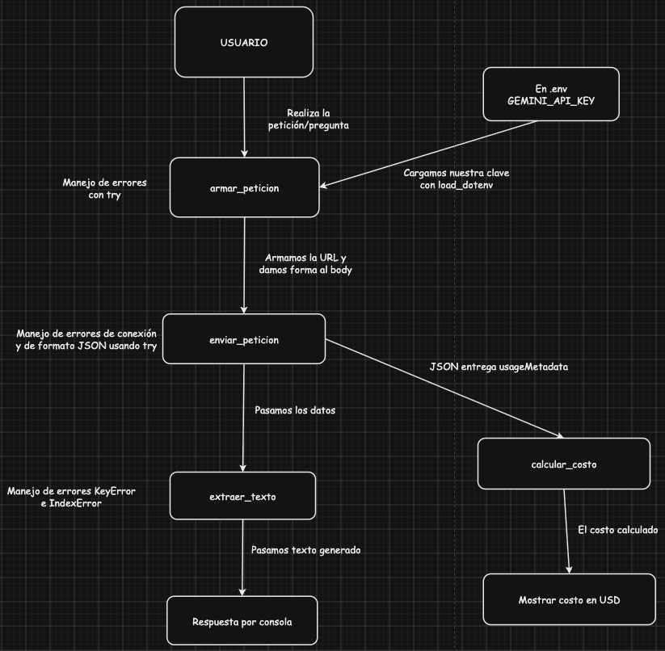

# Chatbot Evidencia

Proyecto de la Especialización en Desarrollo con IA Generativa (Accenture).

Chatbot Evidencia ayuda a investigadores y a tomadores de decisiones de programas sociales y políticas públicas a encontrar programas o políticas que han funcionado en otros contextos y han mostrado un impacto positivo. La primera temática es **prácticas pedagógicas inclusivas**.

## Qué debe cumplir

- Entregar respuestas que citen los documentos utilizados (RAG), para poder verificar la fuente, y que sean precisas, claras y redactadas en español.
- Si no encuentra la respuesta, o se le pregunta por un tema que no tiene documentación, señalar que no tiene esa información, reduciendo al máximo las alucinaciones.
- Tener calidad y un costo razonables para una consulta que dé confianza a los usuarios, y usar un modelo vigente y estable.

## Arquitectura



La decisión de arquitectura (elección del modelo, comparación de candidatos y alternativas descartadas) está en [`docs/documento_decision_arquitectura.md`](docs/documento_decision_arquitectura.md).

## Estado del proyecto

- Conexión autenticada con la API de Gemini funcionando (evidencias en `docs/`).
- Comparación de tres modelos de Gemini con un mismo conjunto de preguntas. Modelo elegido, de forma provisional: **gemini-3.1-flash-lite**.
- Banco de prompts con salida en JSON y una prueba que mide su consistencia.
- Las pruebas actuales usan tres fragmentos ficticios entregados directamente en el prompt. La recuperación de documentos reales (RAG) se incorporará en las etapas siguientes.

## Estructura del repositorio

```
.
├── src/
│   ├── consumir_gemini.py        # conexión con la API de Gemini
│   └── evaluacion_modelos.py     # comparación de modelos (latencia, costo y calidad)
├── prompts/
│   ├── banco.py                  # banco de prompts (BANCO_DE_PROMPTS)
│   ├── test_consistencia.py      # prueba de consistencia del banco
│   └── registro_resultados.json  # resultados de la última prueba (lo genera el script)
├── docs/                         # decisión de arquitectura, diagrama y evidencias
├── tests/                        # pruebas del código
├── requirements.txt              # dependencias de Python
├── .env.example                  # plantilla de variables de entorno, sin valores reales
└── .gitignore                    # archivos ignorados por Git (entorno virtual, .env)
```

- **`src/consumir_gemini.py`**: funciones para armar la petición (`armar_peticion`, con instrucción de sistema y esquema JSON opcionales), enviarla (`enviar_peticion`), extraer el texto (`extraer_texto`), convertirlo en JSON (`parsear_respuesta_json`) y calcular el costo (`calcular_costo`).
- **`src/evaluacion_modelos.py`**: ejecuta 5 preguntas, 4 veces cada una, sobre 3 modelos, y revisa automáticamente si la respuesta tiene el estado, las fuentes y las cifras esperadas.
- **`prompts/`**: el banco de prompts, el script que lo prueba y su registro de resultados.

## Cómo empezar

1. Clona el repositorio y entra a la carpeta del proyecto.
2. Crea tu entorno virtual y actívalo:
   ```bash
   python3 -m venv venv
   source venv/bin/activate        # en Windows: venv\Scripts\activate
   ```
3. Instala las dependencias:
   ```bash
   pip install -r requirements.txt
   ```
4. Copia `.env.example` a un archivo nuevo llamado `.env` y completa tu llave de la API de Gemini (`GEMINI_API_KEY`), que se obtiene en Google AI Studio. El archivo `.env` nunca se sube al repositorio: ya está excluido en `.gitignore`.

## Cómo ejecutar

Todos los comandos se ejecutan desde la **raíz del proyecto**, con el entorno virtual activo, usando `python -m` y el nombre del módulo **sin** `.py`.

| Qué hace | Comando |
|---|---|
| Probar la conexión con la API | `python -m src.consumir_gemini` |
| Comparar los tres modelos | `python -m src.evaluacion_modelos` |
| Probar la consistencia del banco de prompts | `python -m prompts.test_consistencia` |

La comparación de modelos hace 60 llamadas y la prueba del banco hace 20. Con una cuenta del nivel gratuito de Google pueden aparecer errores de cuota (429) o de alta demanda (503). Si el mensaje menciona un límite por día, hay que esperar al día siguiente.

## Banco de prompts

El banco (`prompts/banco.py`) reúne cuatro prompts de la aplicación, cada uno con su instrucción de sistema, un ejemplo de entrada y la estructura JSON que se espera como salida:

| Prompt | Para qué sirve |
|---|---|
| `responder_con_evidencia` | Responder citando los documentos, o indicar que no hay información |
| `clasificar_consulta` | Decidir si la consulta está en el alcance y qué tipo de consulta es |
| `extraer_ficha_programa` | Extraer los datos de un programa desde un fragmento de documento |
| `verificar_afirmacion` | Contrastar una afirmación del usuario con los documentos |

`prompts/test_consistencia.py` ejecuta cada prompt varias veces contra la API real y comprueba que la respuesta sea un JSON válido, con las claves, los tipos y los valores esperados. El resultado queda en `prompts/registro_resultados.json`.

## Reglas que se mantienen durante todo el programa

- Ningún secreto (contraseña, llave de API, token) va escrito directamente en el código ni en ningún archivo que se suba al repositorio.
- Cada proyecto nuevo tiene su propio entorno virtual: no se comparten dependencias entre proyectos distintos.
- Todo el trabajo que se entrega en este programa vive en un repositorio de GitHub, sin excepción.
